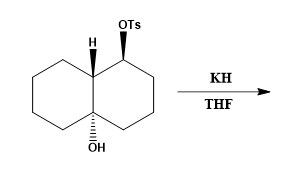

# OC-002 — Grob Fragmentation

**Benchmark domain:** Organic chemistry  
**Topic:** Grob fragmentation  
**Difficulty:** 5/5  
**Evaluation sample:** 5 model responses  
**Status:** Case study prepared from the benchmark record.

## Challenge

Predict the major product from the following substrate and conditions:
## 
- **Starting material:** (1S,4aS,8aR)-4a-hydroxydecahydronaphthalen-1-yl 4-methylbenzenesulfonate
- **Reagents/conditions:** KH, THF
- **Expected product:** (E)-cyclodec-5-en-1-one
- **Required stereochemical outcome:** The alkene in the product is **E**.

The original benchmark prompt was presented with a reaction scheme. The text above records the corresponding substrate, conditions, and expected product.

## Expert answer

The transformation is a Grob fragmentation that opens the fused bicyclic framework to form the ten-membered-ring enone, (E)-cyclodec-5-en-1-one. KH deprotonates the alcohol to form the alkoxide. In the stereoelectronically permitted, concerted fragmentation, the alkoxide forms the carbonyl while the appropriately aligned ring-fusion C–C bond cleaves; the resulting electron reorganization forms the C=C bond as the tosylate leaving group departs. The fused 6,6-ring system is thereby converted into a monocyclic enone with E alkene geometry.

## What this item tests

- Recognition of a concerted fragmentation rather than a conventional substitution.
- Reading the fused-ring framework and predicting the ring-opened product.
- Applying stereoelectronic requirements to bond cleavage and leaving-group departure.
- Predicting the alkene geometry in the product.

## Common model trap

The model may treat the alkoxide as a nucleophile that attacks the carbon bearing the tosylate, predicting an intramolecular ether-forming substitution instead of Grob fragmentation. In the evaluated responses, this appeared as a proposed fused epoxide or fused oxetane. That pathway misses the concerted bond-cleavage and π-bond-forming events required to produce the ring-opened enone.

## Observed model performance

| Model (version recorded in benchmark) | Product correct? | Reasoning correct? | Score |
|---|---:|---:|---:|
| Gemini Flash 3.6 | Yes | Yes | 4/4 |
| DeepSeek-V3 | No | No | 0/4 |
| Grok 4.5-Fast | No | No | 0/4 |
| Sonnet 5 Medium (Claude) | Yes | Yes | 4/4 |
| GPT-5.6 Luna (ChatGPT) | No | No | 0/4 |

**Result in this five-response sample:** 2/5 responses (40%) received full credit; 3/5 (60%) predicted an incorrect product and mechanism. The three incorrect responses proposed alternative intramolecular ether-forming pathways rather than the expected Grob fragmentation.

These figures describe this small, specific evaluation sample. They should not be interpreted as general performance estimates for the models.

## Evaluation focus

A response should receive full credit only if it identifies the ring-opened enone product and gives reasoning consistent with the Grob fragmentation, including carbonyl formation, C–C bond cleavage, alkene formation, and loss of tosylate. A superficially plausible substitution product is not correct.

## Reference recorded in the benchmark

Karnik, A. V.; Hasan, M. “Conformations of cyclic, fused and bridged ring molecules,” in *Stereochemistry* (2021), section on Grob's fragmentation.
