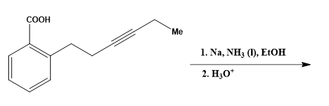

# OC-005 — Birch Reduction with Concurrent Alkyne Reduction

**Benchmark domain:** Organic chemistry  
**Topic:** Birch reduction  
**Difficulty:** 4/5  
**Evaluation sample:** 5 model responses  
**Status:** Case study prepared from the benchmark record.

## Challenge

Predict the major product from the following substrate and conditions:
## 

- **Starting material:** 2-(Hex-3-yn-1-yl)benzoic acid
- **Reagents/conditions:** 1. Na, liquid NH₃, EtOH; 2. H₃O⁺
- **Expected product:** (E)-2-(hex-3-en-1-yl)cyclohexa-2,5-diene-1-carboxylic acid
- **Required stereochemical outcome:** The side-chain alkene is **E**.

The original benchmark prompt was presented with a reaction scheme. The text above records the corresponding substrate, conditions, and expected product.

## Expert answer

The reaction involves two reductions under dissolving-metal conditions. The aromatic ring undergoes Birch reduction to a 1,4-cyclohexadiene; the electron-withdrawing carboxyl group controls the regiochemistry so that the ring carbon bearing the carboxyl group becomes sp³-hybridized. At the same time, the internal alkyne is reduced to the trans (E)-alkene through successive electron-transfer and protonation steps. The acidic work-up restores the carboxylic acid from its carboxylate form. The expected product therefore contains both a partially reduced aromatic ring and an E-alkene in the side chain.

## What this item tests

- Recognizing that the specified conditions can reduce both the aromatic ring and the alkyne.
- Applying Birch-reduction regiochemistry for an electron-withdrawing carboxyl substituent.
- Distinguishing dissolving-metal alkyne reduction (trans/E alkene) from Lindlar reduction (cis/Z alkene).
- Accounting for the acidic work-up.

## Common model trap

The model may identify the alkyne-to-E-alkene conversion but leave the aromatic ring unchanged, giving an incorrect product. It may also apply the wrong Birch regiochemistry or predict a cis alkene, confusing dissolving-metal reduction with Lindlar hydrogenation.

## Observed model performance

| Model (version recorded in benchmark) | Product correct? | Reasoning correct? | Score |
|---|---:|---:|---:|
| Gemini Flash 3.6 | No | Partial | 1/4 |
| DeepSeek-V3 | No | Partial | 1/4 |
| Grok 4.5-Fast | Yes | Yes | 4/4 |
| Sonnet 5 Medium (Claude) | No | Partial | 1/4 |
| GPT-5.6 Luna (ChatGPT) | No | Partial | 1/4 |

**Result in this five-response sample:** 1/5 responses (20%) received full credit. Four responses correctly recognized the side-chain alkyne reduction to an E-alkene but failed to include the Birch reduction of the aromatic ring in the final product.

These figures describe this small, specific evaluation sample. They should not be interpreted as general performance estimates for the models.

## Evaluation focus

Full credit requires the correct product to reflect both transformations: Birch reduction of the aromatic ring with the appropriate regiochemistry, and conversion of the internal alkyne into the E-alkene. Correctly identifying only one transformation is partial reasoning, not a correct product prediction.

## Reference recorded in the benchmark

Baguley, P. A.; Walton, J. C. *J. Chem. Soc., Perkin Trans. 1* (1998), 2073–2082. DOI: [10.1039/A802024H](https://doi.org/10.1039/A802024H).

